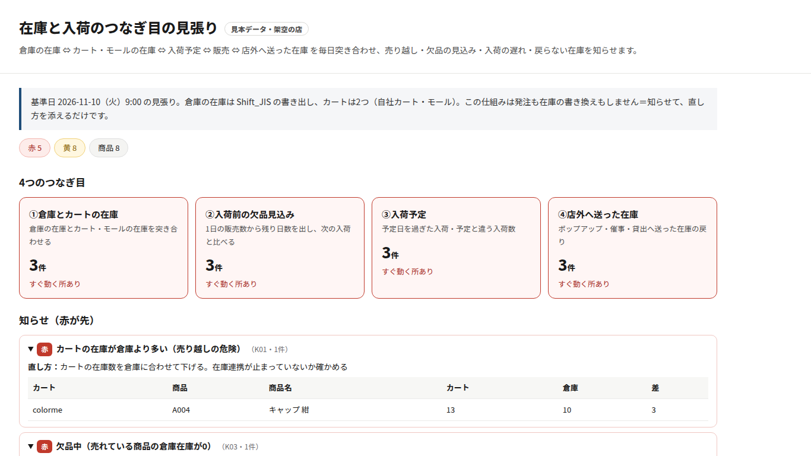

# 在庫と入荷の「つなぎ目」見張り デモ

倉庫の在庫 ⇔ カート・モールの在庫 ⇔ 入荷予定 ⇔ 販売 ⇔ 店外へ送った在庫（ポップアップ・催事・貸出）を毎日突き合わせ、
「売り越し・入荷前の欠品の見込み・入荷の遅れ・戻らない在庫」を知らせる仕組みの画面デモです。

- デモ画面: https://ai-flow-architect.github.io/stock-inbound-watch-demo/
- 赤（すぐ対応）・黄（要確認）の知らせと直し方、商品ごとの残り日数と次の入荷を確認できます
- 発注や在庫の書き換えはしません（知らせて、直し方を添えるだけ）

※ 表示しているデータはすべて架空です。外部のサーバーや鍵には接続していません。

AIフローアーキテクト
